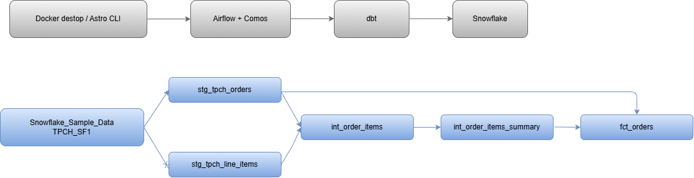
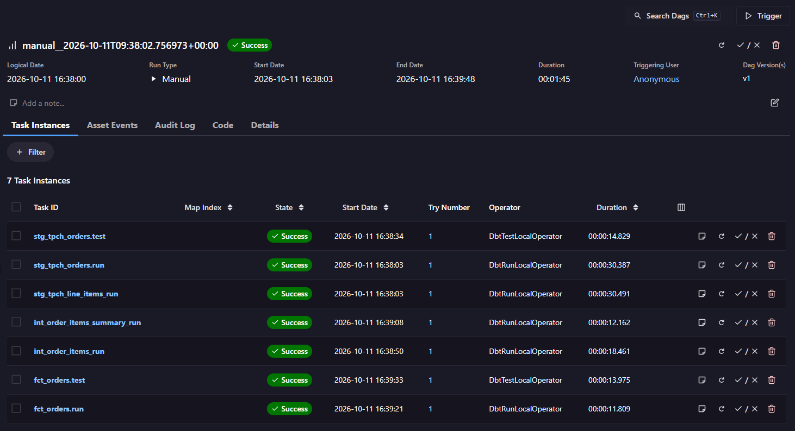
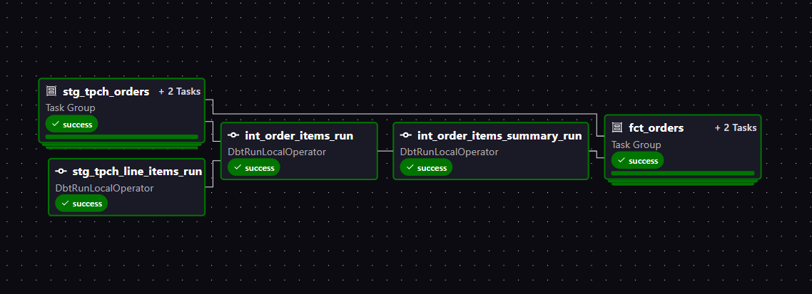

# Code along project - Build ELT Pipeline with dbt, Snowflake and Airflow

## Project overview

Project này sử dụng dữ liệu có sẵn trong `snowflake_sample_data.tpch_sf1` trên Snowflake.

Mình dùng dbt để transform dữ liệu từ hai bảng `orders` và `lineitem`, tạo các staging model, intermediate model và bảng `fct_orders`. Sau đó dùng Airflow kết hợp Cosmos để chạy các model và test theo workflow.

## Tools sử dụng

- Snowflake: Chứa dữ liệu nguồn và các bảng/view sau khi transform.
- dbt: Viết model SQL, macro và test.
- Docker + Astro CLI: Chạy môi trường Airflow trên máy.
- Airflow + Cosmos: Điều phối các task dbt theo DAG.

## Data flow architecture



Dữ liệu đi từ `snowflake_sample_data.tpch_sf1` → staging → intermediate → `fct_orders`. Airflow dùng Cosmos để gọi các task dbt; dbt gửi SQL sang Snowflake để xử lý.

## Các bước mình đã làm

1. **Setup dbt + Snowflake:** Tạo `dbt_wh`, `dbt_db`, `dbt_schema` và khởi tạo dbt project `data_pipeline`.
2. **Config dbt project:** Staging model trả về view, marts model trả về table; cài `dbt_utils` bằng `dbt deps`.
3. **Tạo source và staging model:** Khai báo hai bảng nguồn `orders`, `lineitem`; tạo `stg_tpch_orders` và `stg_tpch_line_items`.
4. **Tạo intermediate model:** Join dữ liệu đơn hàng với từng dòng hàng trong đơn hàng.
5. **Tạo macro và fact table:** Dùng macro tính discount, tổng hợp số liệu theo đơn hàng và tạo `fct_orders`.
6. **Tạo test:** Kiểm tra dữ liệu bằng generic test và singular test.
7. **Chạy trên Airflow:** Tạo `dags/dbt_dag.py`, dùng Cosmos để đưa các model và test của dbt vào DAG.

Phần code và giải thích chi tiết từng bước nằm trong [project_step_by_step.md](project_step_by_step.md).

## Chạy project trên máy

Cần có Docker Desktop, Astro CLI và Snowflake connection tên `snowflake_conn` trong Airflow.

Mở terminal tại thư mục `dbt-dag` và chạy:

```bash
astro dev start
```

Sau khi Airflow khởi động, mở địa chỉ Airflow mà Astro hiển thị trong terminal. Vào DAG `dbt_dag` và chọn **Trigger** để chạy thử.

## Kết quả

Mình đã trigger DAG trên Airflow và các task trong lần chạy này đều thành công.



